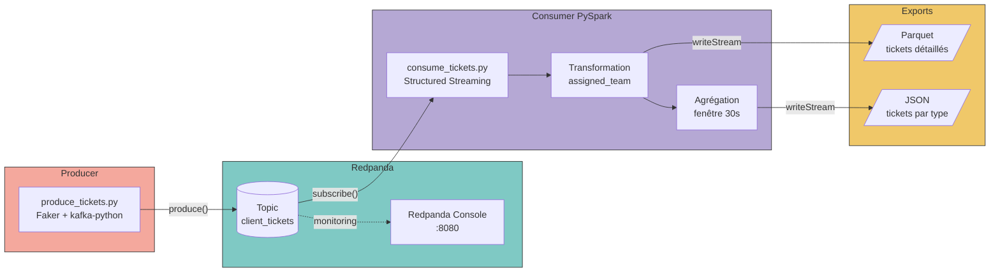

# Ticket Stream Pipeline

Ce projet consiste en un Pipeline de streaming en temps réel pour la gestion de tickets clients(sav, contact mail, etc.), construit avec **Redpanda** (broker compatible Kafka) et **PySpark**, l etout est entièrement conteneurisé avec Docker Compose.

Il s'agit d'un POC simulant l'ingestion et le traitement en temps réel des tickets de support d'une dans n'importe quelle entreprise.

## Contexte

Un système reçoit des tickets clients en continu (ID ticket, ID client, date de création, demande, type de demande, priorité). L'objectif : ingérer ce flux en temps réel, l'enrichir automatiquement (assignation d'une équipe support selon le type de demande) et produire des indicateurs agrégés (nombre de tickets par type), le tout persisté pour analyse ultérieure.

## Architecture du pipeline



**Flux de données** :
1. `produce_tickets.py` génère un ticket client fictif (via Faker) chaque seconde et le publie dans le topic Redpanda `client_tickets`
2. `consume_tickets.py` lit ce topic en continu (Spark Structured Streaming), décode le JSON, et l'enrichit d'une colonne `assigned_team` selon le type de demande comme dans la réalité on dispatch les ticket pour les équipes qui la traiteront.
3. Deux exports en parallèle : le détail de chaque ticket en **Parquet**, et le comptage de tickets par type (fenêtres de 30s) en **JSON**
4. **Redpanda Console** permet de visualiser le topic et les messages en temps réel via l´interface web

## Stack technique

| Composant | Rôle |
|---|---|
| [Redpanda](https://redpanda.com) | Broker de streaming, compatible API Kafka |
| [Redpanda Console](https://redpanda.com/redpanda-console-kafka-ui) | Interface web de supervision du broker |
| Python 3.12 + `kafka-python-ng` | Producteur de tickets |
| Python 3.12 + `Faker` | Génération de données réalistes |
| PySpark 4.2.0 (Structured Streaming) | Traitement du flux, transformation, agrégation |
| Docker Compose | Orchestration des 4 services |

## Structure du projet

```
ticket-stream-pipeline/
├── docker-compose.yml
├── producer/
│   ├── Dockerfile
│   ├── requirements.txt
│   └── produce_tickets.py
├── consumer/
│   ├── Dockerfile
│   ├── requirements.txt
│   └── consume_tickets.py
├── verify_exports.py
└── output/              (généré à l'exécution, ignoré par git)
    ├── tickets_detail/parquet/
    └── tickets_by_type/json/
```

## Installation et lancement

### Prérequis

- Docker et Docker Compose installés

### Démarrage

```bash
git clone https://github.com/mohandab-dataeng/realtime-support-pipeline.git
cd ticket-stream-pipeline
docker compose up --build
```

Cette commande construit les images du producer et du consumer, puis démarre les 4 services : `redpanda-0`, `redpanda-console`, `producer`, `consumer`.

### Vérifier que ça tourne

**Logs du consumer** (tickets traités + agrégations en direct, normalement on devrai voir defiler les ticket arriver) :
```bash
docker logs -f ticket-consumer
```

**Interface web Redpanda Console** (visualiser les messages du topic) :
```
http://localhost:8080
```

**Fichiers exportés**, accessibles directement sur la machine hôte grâce au volume monté :
```bash
ls output/tickets_detail/parquet/
ls output/tickets_by_type/json/
```

### Arrêter le pipeline

```bash
docker compose down
```

## Choix techniques

- **`kafka-python-ng`** plutôt que `kafka-python` : le paquet original est incompatible avec Python 3.12+ (`ModuleNotFoundError` sur `kafka.vendor.six.moves`), ce fork corrige le problème.
- **Connecteur `spark-sql-kafka-0-10_2.13:4.2.0`** : la version doit correspondre exactement à la version de PySpark installée (4.2.0) et à son suffixe Scala (2.13 depuis Spark 4.0+).
- **`BOOTSTRAP_SERVERS` paramétrable via variable d'environnement** : `localhost:19092` en exécution locale, `redpanda-0:9092` en Docker Compose (adressage interne au réseau Docker), un seul code, deux contextes.
- **Healthcheck sur Redpanda** (`rpk cluster health`) : garantit que le producer et le consumer n'essaient de se connecter qu'une fois le broker réellement opérationnel, pas juste démarré.
- **`outputMode("append")` pour les exports fichiers** : contrainte de Spark Structured Streaming, un sink fichier n'accepte pas `update` pour une agrégation avec fenêtre, une fenêtre n'est écrite qu'une fois définitivement close (watermark d'1 minute).

## Démonstration vidéo

[Lien vers la vidéo de démonstration à ajouter ici]

## Auteur

Mohand Abaran - Data Engineer